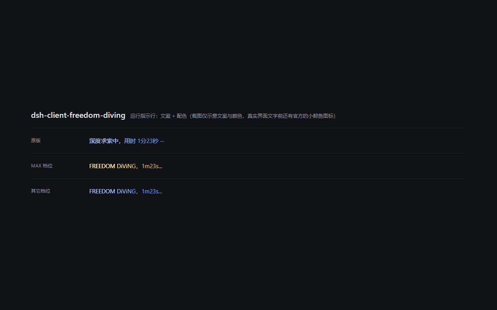

# dsh-client-freedom-diving

[](https://github.com/pigeoncode258/dsh-client-freedom-diving/actions/workflows/ci.yml)
[](LICENSE)

把 DeepSeek Harness（DSH）「正在思考」那一行的 `深度求索中，用时 x分x秒 ···`
换成 **`FREEDOM DiViNG，xmxs...`**，并且**只在推理强度选到 max 时**把它染成帝王金 ——
原来那道从左到右扫过的高亮特效原样保留。



> 预览图用官方运行指示行的 DOM 结构与颜色变量渲染，仅示意文案与配色
> （真实界面里文字前还有官方的小鲸鱼图标）。渲染源见 `docs/preview.html`。

```text
深度求索中，用时 1分23秒 ···   →   FREEDOM DiViNG，1m23s...
                                   max 档位：帝王金    其它档位：原版浅蓝
```

> **English**: a tiny DSH client plugin that rewrites the "deep diving" running
> label to `FREEDOM DiViNG，xmxs...` and paints it imperial gold **only** at the
> top reasoning effort, keeping the original left-to-right shimmer sweep.
> Install with `dsh plugin --profile desktop add 'github:pigeoncode258/dsh-client-freedom-diving'`.

## 它做了什么

| 需求 | 做法 |
| --- | --- |
| 改文案 | 结构化定位 `[data-chat-running] > [data-shimmer]`，就地改写文本节点 |
| `xmxs` 计时 | 读官方渲染出来的本地化耗时（`1分23秒` / `1m 23s` 都认）再换算，不依赖语言 |
| 保留高亮扫过 | 完全不碰 TextShimmer 的动画，只改颜色变量 |
| 只在 max 金色 | 订阅该会话的 ModelDirectory 读当前档位，CSS 只在 `html[data-freedom-diving=max]` 命中 |
| 不动官方代码 | 全程只读 DOM + 注入一条 CSS + 使用官方插槽与服务，不修改任何 `@deepseek-ai` 包 |

几个刻意的设计：

- **幂等**：无论插件重跑多少次、官方文案有没有变，结果都是同一句话，不会叠加成 `FREEDOM DiViNG，FREEDOM DiViNG...`。
- **不打断 React 计时**：改写用文本节点的 `nodeValue` 而不是替换节点，所以官方每秒刷新计时器时写的还是同一个节点，秒数不会卡住。
- **高亮副本一起改**：TextShimmer 会把文字渲染两份（真实内容 + 用 `data-shimmer-text` 复制的高亮层），两份都改，金色高亮扫过时不会露出旧文案。
- **认结构不认类名**：CSS Module 的哈希类名会随版本变化，所以只依赖官方稳定的 `data-chat-running` / `data-shimmer` / `data-shimmer-text`。
- **失败也不影响使用**：拿不到模型目录时只有颜色不生效，文案替换照常；找不到运行指示行时插件不做任何事。

## 安装

要求 DSH ≥ `0.1.0-rc.6`（已在桌面版 `0.2.0-rc.2` 上验证）。

> Web 界面和桌面版是**两个独立 profile**，装到哪个就只在哪个界面生效。

### 从 GitHub 安装

```sh
dsh plugin --profile desktop add 'github:pigeoncode258/dsh-client-freedom-diving'
```

### 从 tarball 或本地目录安装

```sh
npm pack                                     # 得到 dsh-client-freedom-diving-1.0.0.tgz
dsh plugin --profile desktop add ./dsh-client-freedom-diving-1.0.0.tgz
# 开发时也可以直接装目录（link 依赖，改完重新 build 重启即生效）
dsh plugin --profile desktop add .
```

### 手动安装

1. 把整个包目录拷到 `%USERPROFILE%\.dsh\profiles\<profile>\node_modules\dsh-client-freedom-diving`；
2. 在该 profile 的 `package.json` 里登记两处：

```jsonc
{
  "dependencies": { "dsh-client-freedom-diving": "file:./node_modules/dsh-client-freedom-diving" },
  "dsh": { "profile": { "bundles": [ /* …已有的… */ "dsh-client-freedom-diving" ] } }
}
```

3. **完全退出并重新打开 DSH**（客户端插件在启动时装配，刷新页面不够）。

桌面版也可以直接用自带的命令行，不必先装到 PATH：

```powershell
& "<安装目录>\resources\runtime\cli\bin\dsh.cmd" plugin --profile desktop add 'github:pigeoncode258/dsh-client-freedom-diving'
```

## 验证

1. 重开 DSH，进入任意会话；
2. 把 composer 里的推理强度切到 **Max**；
3. 发一条消息：思考时那行应显示 `FREEDOM DiViNG，0m3s...`，颜色是帝王金，高亮仍从左到右扫过；
4. 切到 High / Low：文案不变，颜色回到原版蓝色。

## 卸载

```sh
dsh plugin --profile desktop remove dsh-client-freedom-diving
```

## 开发

```sh
node scripts/build.mjs   # src/client.js -> lib/client.js（零依赖，不需要 esbuild）
npm test                 # 纯逻辑单测（node:test，含产物同步检查）
```

改完源码记得重新 build 并一起提交 `lib/client.js` —— 安装方不会在本地构建，
仓库里必须带着可用的产物（CI 会检查产物是否过期）。

测试分两层：

- `npm test` / `test/pure.test.mjs`：不需要浏览器，覆盖文案换算、档位判定、产物同步；
- `test/dom-test.html`：用浏览器直接打开，40 项断言覆盖 DOM 改写、节点身份、
  React 每秒重渲染后的补写、颜色级联、缺服务降级与卸载清理，标题变成 `ALL PASS` 即通过。

## 参数

改样式只需要动 `src/client.js` 顶部的常量：

| 常量 | 默认 | 说明 |
| --- | --- | --- |
| `PREFIX` | `FREEDOM DiViNG` | 文案前缀（全角逗号在拼接处） |
| `GOLD` | `#f2c14e` | max 档位的正文色 |
| `GOLD_SHIMMER` | `#fff0b0` | max 档位扫过高亮的颜色 |
| `EFFORT_ATTRIBUTE` | `data-freedom-diving` | 承载档位的根属性名 |
| `FALLBACK_TOP_EFFORT` | `max` | 模型目录尚未加载时的兜底档位名 |

## 目录结构

```
├─ package.json           插件清单（dsh.bundle / dsh.client 声明）
├─ cordis.patch.yml       挂载声明：把插件插进 profile
├─ src/client.js          客户端源码（可读，改这个）
├─ src/index.js           宿主端空实现
├─ lib/client.js          构建产物（DSH 实际加载，需要提交）
├─ scripts/build.mjs      零依赖构建脚本
├─ test/pure.test.mjs     node:test 单测
├─ test/dom-test.html     浏览器端自测页
└─ docs/preview.html      README 配图的渲染源
```

## 兼容性

插件不修改任何官方文件，升级 DSH 不会失效：只要官方运行指示行还带
`data-chat-running` / `data-shimmer`（当前所有版本都有）就一直有效。
颜色功能依赖官方 `@deepseek-ai/dsh-client-ui-model-selection` 提供的
`modelDirectories` 服务；即使这个服务不存在，文案替换仍然生效。

## 许可

[MIT](LICENSE)
